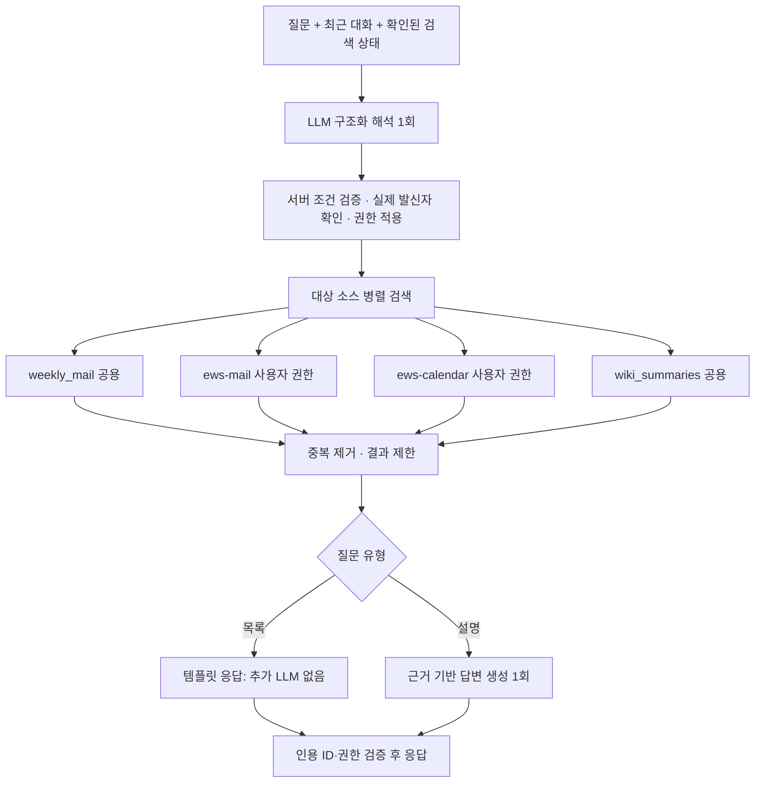

> **이관 시 기준:** [2026-10-18 마이그레이션 설명서](rag-migration-guide-2026-10-18.md)를 먼저 읽으세요. 아래에는 과거 단계의 설정·측정 기록도 포함되어 있습니다. 현재 빠른 경로에는 제한된 Agent 루프가 있으며, 의미 검색 실패는 엄격하게 오류로 반환합니다.

# 빠른 RAG 운영 안내

`/v1/chat`은 질문 해석 1회 → 권한·메타데이터 검증 → 병렬 검색 → 목록 출력 또는 답변 생성 1회로 처리합니다. Deep Research·통계·judge·재계획은 활성 경로에 없습니다. 후속 고급 엔드포인트는 아직 구현하지 않았습니다.



## 실행

기존 환경을 사용해 다음 factory로 실행합니다. 기존 fixture 데모 실행기는 과거 흐름 검증용이며 실제 검색 서비스가 아닙니다.

```bash
python -m uvicorn app.api.main:build_configured_app --factory --host 127.0.0.1 --port 8000
```

- `QUICK_SHARED_SOURCES=true`: 사용자가 승인한 공용 weekly_mail/wiki_summaries 접근. EWS의 employee_id 필터는 계속 필수입니다.
- `QUICK_VECTOR_SOURCES=[]`: 인덱스 임베딩 모델·전처리 호환성을 확인한 소스만 의미 검색을 활성화합니다. 예: `["ews_mail","ews_calendar"]`. 차원 수가 같다는 이유만으로 활성화하지 않습니다. 기본은 BM25입니다.
- `QUICK_DEADLINE_SECONDS=20`: 워크플로 최대 대기시간. 대화 저장·읽기는 각각 최대1초이며 HTTP 전송은 별도입니다.
- `QUICK_SOURCE_TIMEOUT_SECONDS=4`: 소스별 검색 제한.
- `WIKI_INDEX=wiki_summaries`: 실제 현재 인덱스명. EWS 별칭은 기존 설정 유지.
- 해석 모델은 routing 설정, 답변 모델은 answer 설정을 사용합니다. 빠른 OpenAI 호환 경로는 SDK 재시도 0회, 출력 제한 해석1200/답변700토큰입니다.
- API 요청 user_id는 인증된 게이트웨이가 실제 사용자 ID로 설정해야 합니다. 이 변경은 기존 인증 계약을 유지합니다.

최근 목록은 날짜 제한 없이 최신10개, 최근 요약은 최근7일입니다. 명시적인 기간이 우선합니다. 발신자 이름은 실제 권한 내 이메일로 확인하며 동명이인은 재질문합니다. “그중”은 기존 결과 ID를 현재 권한으로 다시 조회합니다. 시간·인물 조건을 지원하지 않는 소스는 조건을 버리지 않고 제외 사실을 안내합니다.

의미 검색 실패 시 키워드 결과와 제한 사항을 반환합니다. 인용 검증은 출처 ID와 권한을 확인하며, 모든 문장의 의미적 정확성을 보장하는 절차는 아닙니다. 실제 모델을 포함한 응답시간은 별도 측정이 필요합니다.

## 이번 실측

사용자 승인한 더미 질문1회에서 현재 `openrouter/free` 해석13.500초, 검색19ms, 워크플로 전체13.523초로 메일10개를 반환했습니다. 임베딩·추가 생성은0회입니다. 한 건의 측정이며 모델/네트워크/부하에 따라 달라집니다. 빠른 고정 routing 모델을 선택할 여지가 있으며 현재 모델 설정은 유지했습니다.

weekly_mail의 기존 OpenSearch 파일 핸들 오류는 승인된 인덱스 재열기로 복구했고360건 보존과 네 소스 검색을 확인했습니다.

## 2026-10-17 실제 UI 오류 수정

기존 openrouter/free의 요청별 모델 변경과 구조화 응답 실패, 공급자 서버 오류가 실제 UI에서 확인됐습니다. 기본 무료 라우터를 사용하는 빠른 경로는 이제 `QUICK_OPENROUTER_FREE_MODEL=nvidia/nemotron-3-super-120b-a12b:free`로 고정하고 이 모델의 선택적 추론을 비활성화합니다. 명시적으로 지정한 다른 routing/answer 모델은 유지합니다.

빈 응답·출력 잘림·잘못된 JSON·요청 제한·공급자 장애는 구별된 LLM 오류 코드와 안내로 반환합니다. 원문 질문·모델 출력은 진단 로그에 저장하지 않고 모델명·종료 사유·출력 길이만 기록합니다. 재시도는 추가하지 않았습니다.

수정 후 전체572개 테스트 통과. 실제 HTTP API에서 인사3.53초, 이번 주 일정 조회2.60초(해당 날짜 자료 없음), 김테스트 발신자 메일10건3.43초. 합성 근거로 설명형 해석+답변 생성3.01초, 인용 검증 통과. 모두 단일 측정이며 평균 지연이나 가용성을 보장하지 않습니다. 테스트 일정은2026-08-03~2026-08-31에 있어 현재10월의 이번 주 조회는 빈 결과가 정상입니다.

UI: `http://127.0.0.1:18765/test-ui`. 서버 재시작 후 화면을 새로고침해 사용합니다.

### 임베딩 제공업체 라우팅 (2026-10-17)
- `OPENROUTER_EMBEDDING_PROVIDERS=["nebius"]`: 로컬 실행은 동일 Qwen3-Embedding-8B 모델의 Nebius 제공 경로로 제한합니다. 비어 있으면 기존 자동 라우팅입니다. 지정 시 다른 업체로 자동 전환하지 않으며 실패는 명시적으로 공개합니다.
- 질문 임베딩은 검색 요청당 한 번 생성해 네 인덱스가 공유합니다. 2026-10-18부터 모델·제공업체·입력 기준 10분 메모리 캐시와 동시 요청 병합을 사용합니다.
- 로컬 `QUICK_SOURCE_TIMEOUT_SECONDS=15`로 검색 단계에 최대 15초, 내부 임베딩에 최대 10초를 허용합니다. 빠른 워크플로 전체 제한 20초는 유지합니다.
- 캐시 없는 더미 질의 3개에서 실제 네 인덱스 kNN 조회가 모두 완료됐습니다: 1.88/8.51/2.13초. 외부 서비스 지연의 보장은 아니며 실제 업무 질문의 정확도 검증과 구분합니다.

### 실메일 검증 후 수정 (2026-10-17)
- 로컬 질문 해석 모델: `OPENROUTER_ROUTING_MODEL=google/gemini-2.5-flash-lite`. OpenRouter 유료 토큰 사용이며 요약 모델 설정은 유지합니다.
- 새 날짜/주차/최근 조건은 `temporal_expression`에 질문 내 실제 시간 표현이 있을 때만 적용합니다. 현재 날짜 자체는 조건의 근거가 아닙니다. 기존 대화에서 확인된 기간은 후속 질문에서 유지합니다.
- 답변 근거 배열을 JSON 문자열로 이중 직렬화하지 않습니다. 이중 이스케이프가 경로 제거 필터에 걸려 발신자/날짜 메타데이터를 손실시키던 오류를 수정했습니다. 보안 필터는 유지합니다.
- 실제 API로 “김테스트가 보낸 메일 요약해줘”를 각각 새 대화에서 검증: 빠르게 6.57초(해석 1.66초), 자세히 11.29초(해석 1.54초). 모두 근거 충분, 인용 유효, 오류 코드 없음, 실제 메일 5건 인용. 두 모드의 근거 선택은 다를 수 있습니다.
- 주간 메일에 발신자 조건을 적용할 수 없어 검색 제외 안내가 표시될 수 있습니다. EWS 메일 조회 실패와 구분합니다. 위 시간은 단일 실측이며 지연 보장은 아닙니다.

## Bounded investigative agent (2026-10-17)

The configured fast endpoint now attaches `FastEvidenceAgent` to `QuickRAGWorkflow`.
It uses the installed LangGraph 1.0.1 prebuilt `create_react_agent` and ToolNode;
Onyx's `chat/llm_loop.py` and `search/search_tool.py` informed bounded iteration,
search-cycle memory and reading neighboring chunks. No Onyx code is copied.
The prebuilt API is deprecated for future LangGraph 2; migrate deliberately with
compatible LangChain dependencies rather than treating this as a new API.

Interpretation yields validated metadata and up to two complementary content queries in one model call. Fast initial retrieval runs the original hybrid query and keyword alternatives concurrently; a new sender-scoped investigation also inspects a bounded sample with the identical filters. Weighted parent RRF fuses results while retaining newly matched passages from the same parent. Production initial retrieval is capped at nine seconds. The embedding gateway has a seven-second total budget including one transient-error retry; retrieval allows 7.5 seconds for it. Strict semantic requests fail explicitly if the primary vector lane fails, rather than presenting surviving keyword lanes as a successful answer. Metadata-only lookup and intentional keyword expansion remain supported.

The LangGraph agent can execute up to three supplemental batches of two parallel keyword searches. Search arguments cannot modify source, sender, dates or ACL. Investigation requests start with search when time allows; simple requests may finish immediately. Relevant passage selection can be included in the search call. If no new evidence appears, that selection is reused without another model call; otherwise the agent can select or search again. Stop on duplicate queries, no new passage, round cap or time budget. Four decision calls plus final generation and interpretation are the maximum (six model calls), not a fixed cost.

The existing twenty-second request deadline remains, with six seconds reserved for final generation. Prior evidence restoration is capped at 1.5 seconds; decisions and supplemental retrieval are separately bounded. Provider failures or an answer taking longer than the remaining budget can still produce a timeout. These are limits, not a latency guarantee.

Evidence has stable document IDs and per-document passage IDs. The final model input is rebuilt from selected excerpts, metadata and actual execution records; previous answer text is excluded. A follow-up that runs out of selection time falls back to reauthorized prior cited evidence when available instead of treating unreviewed routine reports as new progress. New matches within an existing parent count as progress. Explicit sender identity cannot be replaced by a name inferred only from body text. Citation validation checks identifiers/ownership, not semantic entailment.

`QUICK_AGENT_MODEL` optionally selects a model using the configured routing endpoint/client. The local test uses paid `google/gemini-2.5-flash` through OpenRouter, a512-token reasoning budget and2400-token output limit; interpretation retains Flash-Lite. Detailed mode retains its earlier implementation. UI and response diagnostics include timings, actual query attempts, supplemental batch count, selected passage count and stop reason.

Regression tests cover parallel execution and partial failures, constraints, new-parent and same-parent evidence, passage selection, delayed decisions, restoration budgets, duplicate searches, sender continuity and SDK tool calls. Live tests use existing stored Kim-test documents; the current alias points to a dummy-named index. No new documents are seeded, and this does not verify production mail or corpus-wide absence.

### Embedding stability (2026-10-18)

Production requires successful vector retrieval for semantic base queries. The historical 3-second embedding and 4-second initial cutoffs, including the default source timeout-derived 2.67-second inner cutoff, are replaced by coordinated limits. OpenAI SDK automatic retries are disabled; the gateway retries a transient failure once within its seven-second budget. Bounded in-memory cache: 128 entries, 600-second TTL; no mail content is cached here. Concurrent identical embedding requests share one task; caller cancellation does not cancel another waiter. External outage still returns VECTOR_SEARCH_UNAVAILABLE, never a silent keyword-only success. Execution metadata exposes vector_sources.

### Provider tail latency and content topic correction (2026-10-18)

A traced Nebius request finished uploading at 0.004s but response headers arrived at 4.132s, exceeding the 4s per-attempt read timeout. Retrying the same pinned provider could exhaust the 7s total embedding budget. Local configuration now explicitly uses DeepInfra first and Nebius second for the same qwen/qwen3-embedding-8b model. After 1.5s without a valid primary result, a second provider request starts; the first valid vector wins and the loser is cancelled. A transient primary error starts the backup immediately. Maximum two provider requests; seven-second overall budget unchanged. Single-provider configurations retain their one-retry behavior. Each attempt logs provider, duration and exception class without query text or vectors.

Provider compatibility sample: 12 matching query pairs had 4096 dimensions and cosine 0.9949–0.9978, rather than exact vector equality. Four queries across four existing indices showed 80–100% top-five result overlap. This is sampled compatibility evidence, not identical ranking assurance.

conditions.topic is exact wiki metadata only for explicit wiki scope. In mail, calendar, report and all-source requests, a returned topic is moved to the content query before search; sender, dates and access filters are preserved. Applied after conversational merge and again at retrieval boundaries to cover follow-ups and tool calls. Schema and interpreter prompt convey the distinction.

The uncached mail tests also exposed inferred mail_type=other on ordinary mail questions: identical content/sender search returned 0 documents with this filter and 5 without it. Prompt/schema now prohibit this inference. Workflow permits category filters only when the current user explicitly requests the category, an explicit API filter is present, or an owner-bound follow-up retains the same category with previously validated provenance. QuickPlan.mail_type_expression records that provenance; API filters record their canonical type. Category removal does not alter sender/ACL constraints.
