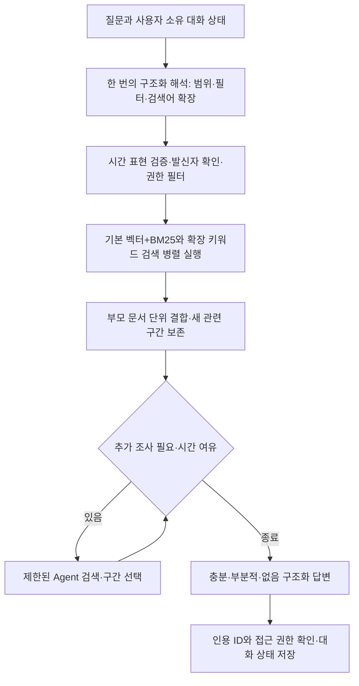

# GPT Luna용 RAG 마이그레이션 설명서

작성: 2026-10-18 KST. 대상은 10/17–18 누적 RAG 작업분입니다. 모든 파일이 10/18에 새로 만들어졌다는 뜻은 아닙니다.
현재 원격: `https://github.com/dorothy90/leader_weekly_summary.git`, 브랜치 `dorothy90/ews`.
사내 레포 주소는 아직 지정되지 않았으며 사내 배포는 수행하지 않았습니다.

## 전달물과 적용 방식

`rag-file-inventory-2026-10-18.md`의 변경 파일이 이번 이관 범위입니다. 전달 ZIP의 `changed/`는 해당 파일 원본이며 `runtime-baseline/`은 변경되지 않은 의존 모듈을 포함한 app 전체, tests/mail_rag 전체 및 requirements.txt입니다. 실제 메일·대화 DB·환경 비밀·벡터 데이터는 포함하지 않습니다.

동일 Git 이력의 레포라면 해당 커밋을 cherry-pick하거나 동봉 패치에 `git apply --check` 후 적용합니다. 기반 커밋: 5343ecabe8aed124e73b76e9b7fef652f76ece00. 다른 사내 레포라면 패치를 강제 적용하지 말고 아래 순서로 어댑터를 이식합니다. `runtime-baseline/`도 무조건 덮어쓰지 않습니다. 기존 인증·저장소·로깅 계약을 먼저 비교합니다.

## 구현 흐름



- `/v1/chat`: 빠르게. 최대 추가 검색 3배치, 배치당 2검색어. 중복 검색·새 근거 없음·시간 예산에서 종료합니다. 최대 LLM 호출은 해석+판단4회+생성=6회이며 항상 2회인 구조가 아닙니다.
- `/v1/chat/detailed`: 자세히. 최대 3개 병렬 검색 과제, 관련도 점검, 필요시 보완 검색 1회. 빠르게의 Agent 루프와 동일 구현이 아닙니다.
- `/test-ui`: 테스트용 화면. 완료 응답을 한 번에 표시하며 스트리밍은 구현하지 않았습니다.
- `main.py`에서 기존 research 라우터 등록을 제거했습니다. 기존 호출자가 있다면 이 변경을 배포 공지하고 전환합니다. `build_configured_app` factory로 실행하며 예전 `app` 객체 실행 방식은 사용하지 않습니다.
- Onyx의 검색/반복 구조를 참고한 구현이며 Onyx 자체 이식이나 기능 동등 구현은 아닙니다. LangGraph prebuilt create_react_agent를 사용하며 향후 버전에서 제거 예정인 API 경고가 있습니다.

## 필수 이식 순서

1. 사내 브랜치를 만들고 현재 인증, ChatRequest/Response, 인덱스 매핑, Mongo 대화 모델을 읽습니다. 파일 목록과 import 의존성을 대조합니다.
2. domain/quick_rag → retrieval/embedding 및 quick_rag → llm/quick_rag 및 gateway → graphs/quick_rag, fast_agent, detailed_rag 순서로 옮깁니다.
3. 기존 domain/evidence, domain/errors, security, observability, persistence, retrieval/opensearch 등 실제 import 의존 모듈을 baseline과 비교해 연결합니다. 신규 6개 파일만 복사해서는 실행되지 않습니다.
4. config/ai, config/settings, api/dependencies, domain/chat, persistence/conversations, api/routes/chat, api/main을 대상 레포 계약에 맞게 병합합니다. QuickMemory는 기존 대화에도 없을 수 있는 선택 필드입니다. 소유자 검증과 현재 권한 재검증을 유지합니다.
5. 데이터는 삭제·재생성하지 않습니다. 아래 소스/필드 어댑터를 확인하고 기존 인덱스 모델과 질문 모델의 호환성을 검증합니다. sender_name이 없으면 정식 수집 파이프라인에서 보강합니다. seed 스크립트는 개발용이며 운영에서 실행하지 않습니다.
6. 테스트 전체와 실제 권한 있는 사용자로 smoke test를 수행한 뒤 제한 사용자에게 배포합니다. 되돌릴 때는 이관 커밋 revert, 이전 설정 복원, 이전 서비스 버전 재배포를 사용합니다. DB·인덱스 삭제는 롤백 절차가 아닙니다.

## 소스·권한·필드 계약

| 논리 소스 | 설정 키 / 현 기본값 | 중요 메타데이터 |
|---|---|---|
| weekly_mail | MAIL_CHILD_INDEX / weekly_mail | team, week, mail_type, source_id |
| wiki_summary | WIKI_INDEX / wiki_summaries | team, week, topic, summary_type, created_at, updated_at |
| ews_mail | MAIL_INDEX_ALIAS / ews-mail-active | employee_id, sender_name, sender_email, received_at, sent_at, source_id, chunk_index |
| ews_calendar | CALENDAR_INDEX_ALIAS / ews-calendar-active | employee_id, organizer_email, attendee_emails, start_at_utc, end_at_utc, location, source_id |

본문은 title/subject/text/page_content/body 등 소스별 FIELDS를 확인합니다. 벡터 필드는 현재 `embedding`입니다. 정확한 DSL, keyword 하위 필드, 날짜 필드 처리는 retrieval/quick_rag.py가 기준입니다. 사내 매핑과 다르면 어댑터와 테스트를 함께 수정합니다.

weekly/wiki 공용 접근은 이 프로젝트 사용자의 승인에 따른 QUICK_SHARED_SOURCES 설정입니다. 사내 권한 정책에 자동 적용하지 않습니다. EWS employee_id 필터와 대화 소유자 검증은 모든 검색/재조회/추가 조사에 유지합니다. 요청 JSON user_id는 인증 수단이 아니므로 사내 인증 게이트웨이에서 인증된 ID로 강제 설정해야 합니다. 테스트 UI는 운영 공개를 제한합니다.

메일 주제는 내용 검색어입니다. wiki 범위가 아닌 topic 조건은 내용 검색으로 이동합니다. mail_type=other를 일반 메일 질문에 임의 추론하지 않습니다. 날짜는 질문에 실제 시간 표현이 있거나 검증된 대화 조건을 계승할 때만 사용합니다.

## 환경 설정 예시

비밀값은 사내 secret manager나 배포 환경에서 주입합니다. 기존 .env를 복사하거나 Git에 올리지 않습니다. 아래 모델/공급자는 이 환경의 검증 대상이며 사내 반출 정책·모델 가용성을 확인한 뒤 선택합니다.

```dotenv
LLM_PROVIDER=openrouter
OPENROUTER_ROUTING_MODEL=google/gemini-2.5-flash-lite
QUICK_AGENT_MODEL=google/gemini-2.5-flash
OPENROUTER_EMBEDDING_MODEL=qwen/qwen3-embedding-8b
OPENROUTER_EMBEDDING_PROVIDERS=["deepinfra","nebius"]
OPENROUTER_EMBEDDING_HEDGE_DELAY_SECONDS=1.5
QUICK_VECTOR_SOURCES=["weekly_mail","wiki_summary","ews_mail","ews_calendar"]
QUICK_SHARED_SOURCES=true
QUICK_DEADLINE_SECONDS=20
QUICK_SOURCE_TIMEOUT_SECONDS=9
DETAILED_DEADLINE_SECONDS=45
DETAILED_RERANK_TIMEOUT_SECONDS=8
DEFAULT_USER_TIMEZONE=Asia/Seoul
```

추가 필수 설정: OPENROUTER_API_KEY, 답변 모델 OPENROUTER_ANSWER_MODEL, OpenSearch 연결/자격증명/TLS, MONGO_URI/MONGO_DB, 인덱스 별칭. 실제 변수 이름은 config의 정의를 우선합니다. 위 예시는 완전한 연결 파일이 아닙니다. QUICK_VECTOR_SOURCES 기본값은 빈 목록이므로 설정을 누락한 채 벡터 검색이 활성화됐다고 판단하면 안 됩니다. 호환성이 확인된 소스만 지정합니다. 다른 임베딩 모델 사용 시 기존 데이터도 같은 모델/전처리로 별도 인덱스에 재임베딩하고 검증 후 별칭을 전환합니다. 차원만 같다고 호환되지 않습니다.

현재 질문 임베딩은 동일 Qwen 모델의 DeepInfra 우선, 1.5초 지연 시 Nebius 추가 요청, 유효 응답 선착순 사용입니다. 전체 7초 제한은 늘리지 않았습니다. 다중 공급자 최대 2요청, 단일 공급자는 일시 오류 재시도 1회입니다. 보조 호출은 비용 증가 가능성이 있습니다. 캐시 128개/600초 및 동일 요청 병합이 있습니다. 의미 검색 기본 경로 실패 시 VECTOR_SEARCH_UNAVAILABLE로 명시하며 키워드만 성공한 것처럼 숨기지 않습니다. 확장 검색 자체의 키워드 경로는 의도된 설계입니다.

## 실행·테스트

Python 3.11 환경에서 검증했습니다. 전체 테스트는 원본 레포의 기존 fixtures 및 설정 파일도 사용하므로 ZIP만으로 독립 설치되는 제품은 아닙니다. 원본 레포 checkout에서 실행하거나 사내 대상 레포에 기존 테스트 의존성을 이식하세요. requirements.txt의 허용 범위가 넓으므로 사내에서는 아래 검증 버전을 기준으로 별도 lock을 만들고 테스트합니다. 기존 uv.lock이 이번 환경과 일치한다고 가정하지 않습니다.

- langgraph==1.0.1
- langchain-core==0.3.83
- langchain-openai==0.3.0
- openai==1.58.1
- pydantic==2.10.4
- fastapi==0.109.0
- httpx==0.28.1
- opensearch-py==2.4.2
- pytest==8.4.2

```bash
python -m pip install -r requirements.txt
python -m pytest tests/mail_rag -q
python -m uvicorn app.api.main:build_configured_app --factory --host 127.0.0.1 --port 18765
```

POST /v1/chat 요청은 {"user_id":"인증된ID","message":"김테스트가 보낸 메일 중 문제가 있는 내용을 조사해줘"}. 이후 응답의 conversation_id를 다음 요청에 넣어 아래 후속 질문을 순서대로 보냅니다. 실제 메일 외부 전송은 사내 승인 정책에 따릅니다.

1. 그러니까 그 문제의 원인과 진행 경과, 조치 내용을 더 조사해줘.
2. 앞서 확인한 내용 이후에 추가로 확인된 게 있어?
3. 확정된 원인과 실제 완료된 조치만 정리하고 확인되지 않은 내용은 구분해줘.

검수: sender/ACL 유지, 임의 날짜·mail_type 없음, vector_sources에 실제 검색 소스 기록, 실행하지 않은 검색을 했다고 말하지 않기, 근거 없는 원인·완료 주장 금지, 동일 문제의 새 근거가 있을 때만 진행 경과로 연결하기. ID 유효한 인용만으로 의미적 정확성이 입증되지는 않습니다. 동일 질문의 문장 차이보다 사실/출처/상태를 평가합니다. 외부 임베딩 안정성은 테스트 전용 인스턴스에서 캐시 TTL을 0으로 설정하고 서로 다른 질문으로 연속 측정합니다. 전체 시간과 해석·임베딩·검색·Agent 판단·생성 시간을 분리해 p50/p95/실패율을 수집합니다.

## 검증된 범위와 아직 남은 문제

- 커밋 전 재실행: 638 passed, 14 warnings, 22.67초. 경고는 LangGraph deprecated API 관련입니다.
- 캐시 없는 서로 다른 질문 20개: 임베딩 20회와 네 인덱스 kNN 80회 성공. 임베딩 중앙값 0.743초, 범위 0.699–1.062초. 장기 가용성을 보장하지 않습니다.
- 기존 저장 김테스트 문서 8질문: 벡터 성공, 답변 5.802–10.762초. 테스트 별칭은 dummy 명칭의 기존 인덱스를 가리키며 실제 운영 메일 검증이라고 표현하지 않습니다. 새 합성 자료를 생성해 테스트한 것은 아닙니다.
- 같은 대화 4턴 실측: 10.634 / 11.032 / 14.465 / 12.017초. 모두 EWS 벡터 검색 성공, 근거 상태 partial. 완성된 조사 품질로 판정하지 않았습니다.
- 미해결 P1: 일반 수율 업무 기록이 해당 Leakage 사건의 조치로 연결되는 표현 위험. 사건 식별/연결 근거를 별도로 추적해야 합니다.
- 미해결 P1: 중복 쿼리로 추가 검색을 생략한 턴에서도 답변이 추가 검색을 시도했다고 설명할 수 있음. 현재 턴의 실제 실행 기록만 행동 서술의 근거로 사용하도록 강화해야 합니다.
- 미해결 지연: 검색이 빨라도 Agent 판단과 최종 생성이 오래 걸릴 수 있습니다. 한 턴 판단 7.451초/생성 5.174초가 관측됐습니다.
- 해당 발신자 권한 내 정확한 Leakage 키워드 확인에서는 문제 보고/회의 예정 1건만 발견했습니다. 확정 원인이나 완료 조치를 만들어낼 수 없고, 전체 저장소에 정보가 없다는 증명도 아닙니다.

## GPT Luna에게 전달할 작업 지시

> 첨부 파일 목록과 이 설명서를 읽고, 사내 레포의 인증·인덱스·모델·대화 저장 계약을 먼저 조사해라. changed 파일과 runtime-baseline 의존성을 비교해 이식 계획 및 필드 대응표를 작성한 뒤 기존 기능을 보존하며 구현해라. 키/실메일/테스트 더미 데이터를 커밋하지 마라. 기존 문서의 과거 수치나 기본 BM25 안내보다 현재 구현과 이 문서를 우선하라. 속도우선의 병렬 확장, 관련 구간 보존, 제한된 Agent 루프, 엄격한 벡터 실패, 권한 검증을 유지해라. 위 P1 미해결 문제를 해결했다고 가정하지 말고 사건 연결 및 실제 검색 실행 기록을 검증하는 테스트부터 추가해라. 근거 충분/부분적/없음과 확인된 내용/부족한 내용을 유지하고 고정 거절 문구로 덮지 마라. 전체 회귀 테스트, 사내 승인 자료의 연속 후속 질문, 캐시 없는 다질문 지연 측정을 수행하고 실패와 한계를 그대로 보고해라. 운영 인덱스 삭제·더미 seed·강제 push 없이 검토 가능한 커밋으로 제출해라.
